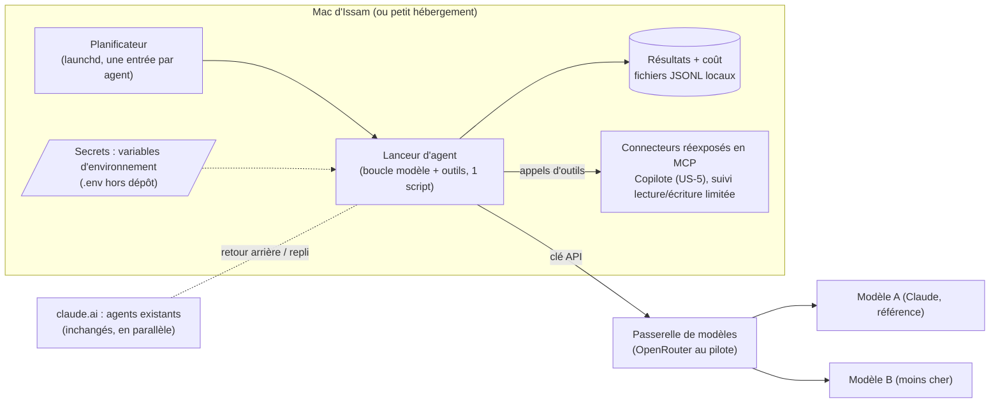

# US-8 — Alternative de modèles pour les agents (étude d'architecture)

Phase 1 de l'histoire US-8. **Aucun code, aucun compte, aucune clé, aucun appel à un fournisseur de modèles n'a été fait.** Ce dossier attend la validation d'Issam (porte de la phase 2). Date : 24/11/2026. Faits externes consultés le 24/11/2026 (sources en §3 et §5).

## 1. Besoin et état actuel

**Besoin (Issam, 24/11).** Réduire le coût des agents et avoir une solution de repli quand le plan claude.ai est saturé (OpenRouter « ou similaire »). Il exige l'étude et sa validation avant tout développement, puis un pilote en infrastructure as code (rg-37), puis une doc d'installation et d'exploitation simple.

**État actuel.**
- Les agents tournent comme tâches planifiées claude.ai : Veille et Coach (≈ 5 passages par jour), Terrain et PO, Chercheur d'outils, Développeurs, Observateur et Profil, et les tâches Matin, Formateur, Bilan, Contrôle qualité, Point hebdo, Rapport mensuel.
- Connecteurs utilisés : Gmail, Drive, Calendar, suivi (artifact, base lue et écrite par les agents), Copilote (US-5 : route HTTP MCP à jeton, lecture seule, via un tunnel ; le Mac doit être allumé).
- Un seul fournisseur et un seul plan (Pro). Au 24/11 : 31 % de la semaine consommée (14 % sur 5 h), remise à zéro lundi 30/11.
- **Le coût par passage n'est pas mesurable aujourd'hui** : les sessions des tâches cloud ne sont pas lisibles depuis l'agent principal (constat du KPI du 24/11). Le plan est un forfait : l'euro/dollar par passage n'existe pas ; seule la part de limite consommée se lit.
- Cibles de coût par passage (rg-27, en équivalent tarif public) : Veille ≤ 0,25 $ (Sonnet) ; Chercheur ≤ 0,80 $ ; Terrain et PO ≤ 1,50 $ (Opus) ; Observateur et Profil ≤ 3,00 $ (Opus) ; Développeurs ≤ 0,05 $ sans go, ≤ 5 $/jour avec go ; enveloppe ≤ 25 $ par semaine.

**Point important pour la décision.** Passer par une passerelle, c'est passer d'un forfait (coût marginal nul jusqu'à la limite) à un paiement au jeton. Cela ne réduit le coût *réel* que si le modèle utilisé est nettement moins cher que le forfait « équivalent » et que le forfait est de toute façon saturé ou sous-utilisé. Le vrai gain à court terme est le **repli** et la **mesure**, pas l'économie.

## 2. Architecture cible (pilote)



Rôles :
- **Planificateur** : une entrée launchd (macOS) par agent, décrite dans un fichier versionné. Rien dans claude.ai n'est modifié.
- **Lanceur d'agent** : un petit script (consigne de l'agent versionnée + boucle « le modèle demande un outil → on l'exécute → on renvoie le résultat »). Il impose les plafonds (jetons, nombre de tours, coût par passage) et écrit chaque passage.
- **Passerelle** : une adresse et une clé uniques vers plusieurs modèles, avec repli d'un modèle à l'autre et facturation unifiée.
- **Connecteurs en MCP** : seul le Copilote est déjà réexposé. Gmail, Drive, Calendar et le suivi ne le sont pas (voir §4).
- **Stockage** : un fichier JSONL par jour (agent, modèle, jetons entrée/sortie, coût, durée, statut, jamais le contenu des mails). Lisible par l'agent principal pour le bilan rg-27.
- **Secrets** : clé de passerelle et jeton Copilote en variables d'environnement locales, modèle `.env.example` sans valeur ; jamais dans le dépôt, le chat ou le suivi.

## 3. Options de passerelle comparées

Sources consultées le 24/11/2026 par recherche web (pages officielles citées ; les agrégats tiers sont signalés).

| Critère | OpenRouter | Vercel AI Gateway | LiteLLM auto-hébergé | Rester sur claude.ai avec plafonds |
|---|---|---|---|---|
| **Prix et frais** | Prix des fournisseurs repassés sans majoration sur l'inférence ; frais à l'achat de crédits (≈ 5,5 %, minimum ≈ 0,80 $ selon des guides tiers ; **chiffre officiel non relu**). Options BYOK avec franchise puis ≈ 5 % (sources discordantes). | Aucune majoration ni frais de plateforme sur les jetons (doc officielle). Offre gratuite : 5 $ de crédit par mois sur un sous-ensemble de modèles ; acheter des crédits supprime ce crédit gratuit. | Logiciel libre, gratuit ; on paie les fournisseurs en direct (une clé par fournisseur) + l'hébergement. | Forfait Pro déjà payé ; pas de coût marginal jusqu'à la limite. |
| **Outils / MCP** | Appel d'outils selon le modèle (pas universel) ; une requête avec outils vers un modèle sans outils échoue ou ignore les outils. Compatible API OpenAI. MCP : à implémenter côté lanceur. | Compatible API OpenAI/Anthropic, kit de développement AI SDK avec outils ; MCP côté lanceur. Non vérifié en détail. | Passerelle MCP intégrée (déclarée dans la config, clés virtuelles) selon la doc ; page de référence non relue. | Connecteurs natifs claude.ai (Gmail, Drive, Calendar, suivi) : tout fonctionne aujourd'hui. |
| **Zéro rétention** | Paramètre par requête `zdr: true` (et `data_collection: "deny"`) : n'envoie qu'à des fournisseurs sans rétention ; pas de journal des prompts sauf opt-in. Ne couvre pas les plugins/outils activés. | ZDR par requête pour Pro/Enterprise sans surcoût ; ZDR pour toute l'équipe : 0,10 $ pour 1 000 requêtes ; le crédit gratuit ne compte pas pour le ZDR. | Dépend de chaque fournisseur choisi (contrat direct) ; la passerelle est chez nous et ne retient que ce qu'on configure. | Politique Anthropic/claude.ai déjà acceptée par Issam. |
| **Résilience** | Repli de fournisseur automatique ; repli de modèle sur liste ordonnée (à ordonner, avec un modèle fiable en dernier). Point de panne unique : OpenRouter. | Repli de modèles et budgets par clé/projet. Point de panne unique : Vercel + dépendance à un compte Vercel. | Pas de panne tierce de passerelle, mais c'est **notre** service : s'il tombe (Mac éteint), plus rien. | Une seule dépendance, mais aucun repli quand la limite est atteinte (le problème de départ). |
| **Charge d'exploitation** | Très faible (service géré, 1 clé, plafond = crédit prépayé). | Faible (compte Vercel, clé gateway, budgets). | Moyenne à élevée : conteneur + base Postgres (clés/budgets), mises à jour, supervision, clés fournisseurs multiples. | Nulle. |
| **Compte à créer** | Oui (par Issam) | Oui (compte Vercel, plan payant pour ZDR) | Un compte par fournisseur de modèle | Non |

Sources : [OpenRouter, FAQ](https://openrouter.ai/docs/faq) ; [OpenRouter, ZDR](https://openrouter.ai/docs/guides/privacy/zero-data-retention) ; [OpenRouter, repli et résilience](https://openrouter.ai/blog/insights/reliability-failover/) ; [OpenRouter, appel d'outils](https://openrouter.ai/blog/tutorials/tool-calling/) ; [OpenRouter, évolution des frais BYOK](https://openrouter.ai/blog/announcements/1-million-free-byok-requests-per-month) ; [Vercel AI Gateway, tarifs](https://vercel.com/docs/ai-gateway/pricing) ; [Vercel AI Gateway, FAQ](https://vercel.com/docs/ai-gateway/faq) ; [LiteLLM, démarrage Docker](https://docs.litellm.ai/docs/proxy/docker_quick_start.md) ; [LiteLLM, mise en production](https://docs.litellm.ai/docs/learn/enterprise_quickstart) ; [Anthropic, tarifs API](https://platform.claude.com/docs/en/about-claude/pricing).

**Non vérifié (à ne pas tenir pour acquis).**
1. Le pourcentage exact et actuel des frais d'achat de crédits OpenRouter (guides tiers : ≈ 5,5 %, min. ≈ 0,80 $) et l'évolution annoncée des frais BYOK.
2. Les tarifs des modèles non-Claude (aucun n'a été relevé ; le choix du modèle B est repoussé à la porte de validation).
3. La disponibilité des modèles Claude via OpenRouter au tarif de la doc Anthropic (non relevé).
4. Le fonctionnement concret du MCP dans chaque passerelle (la page de référence LiteLLM n'a pas été relue ; pour OpenRouter et Vercel, le MCP se fait côté lanceur, à tester au pilote).
5. Les conditions contractuelles (DPA, localisation des données) : à lire par Issam / la conformité inwi avant des données réelles hors Anthropic. Issam a autorisé les données réelles pour le pilote le 24/11 ; je recommande néanmoins le ZDR obligatoire.
6. Si les sessions claude.ai peuvent être lues/mesurées autrement qu'aujourd'hui (non, selon le KPI du 24/11).

## 4. Faisabilité agent par agent

Le facteur décisif : **Gmail, Drive, Calendar et le suivi sont des connecteurs claude.ai**. Tant qu'ils ne sont pas réexposés (MCP à jeton comme le Copilote, ou outils à nous), un agent hors claude.ai ne peut ni lire les mails du jour, ni créer un brouillon, ni écrire dans le suivi. Réexposer Gmail demande un accès Google (compte, consentement OAuth, clés) : **action d'Issam, hors périmètre de cette étude**.

| Agent / tâche | Migrable ? | Raison et risque de qualité |
|---|---|---|
| **Veille et Coach** | **Pilote en « mode ombre »** | Lit l'état (suivi, Copilote pour l'historique, instantané des mails du jour exporté), produit un résumé et des brouillons *texte* dans un fichier local. Pas d'écriture Gmail ni de brouillon réel : aucun envoi, aucun risque. Qualité à comparer : faits exacts, routage rg-33 (À/Cc, « à compléter », historique cité). Le routage des brouillons est le point fragile (qualité d'outil des modèles non-Claude). |
| Chercheur d'outils | Plus tard | Recherche web : dépend des outils de recherche du modèle ; peu de données internes. Candidat n°2. |
| Terrain et PO | Non pour l'instant | Raisonne sur mails et suivi ; plafond Opus élevé. Garder sur claude.ai tant que la qualité n'est pas mesurée. |
| Développeurs | Non | Édition de code et de dépôt : outils riches, qualité critique. |
| Observateur et Profil | Non | Observe le poste local avec des outils claude.ai ; données les plus sensibles. |
| Matin, Bilan, Contrôle qualité, Point hebdo, Rapport mensuel, Formateur | Non | Ils dépendent de Calendar/Gmail/suivi et du jugement de l'agent principal. À reconsidérer après réexposition des connecteurs. |

Règle de décision proposée : un agent ne migre que si (a) tous ses outils existent côté lanceur, (b) 5 passages parallèles ne montrent aucune régression des faits et du routage, (c) le coût mesuré est inférieur à la cible rg-27.

## 5. Coût

**Hypothèses (à remplacer par des mesures au pilote).**
- Passage de veille type : ≈ 100 000 jetons d'entrée (instructions, état du suivi, extraits, mails) et ≈ 5 000 de sortie. Cette taille est cohérente avec la cible rg-27 de 0,25 $ au tarif Sonnet. **Non mesurée.**
- Tarifs publics Anthropic relevés le 24/11 sur la page de [tarifs API](https://platform.claude.com/docs/en/about-claude/pricing) : Sonnet 5.5 : 2 $ entrée / 10 $ sortie par million de jetons ; Haiku 5.5 : 0,10 $ / 0,50 $ pour les prompts ≤ 100 000 jetons (au-delà : 0,50 $ / 2,50 $, appliqué à toute la requête). La page est incohérente d'une version à l'autre : **relire le tarif en direct avant le pilote.**

| Scénario (par passage) | Calcul | Coût |
|---|---|---|
| Sonnet 5.5 | 0,1 M × 2 + 0,005 M × 10 | ≈ 0,25 $ (= la cible) |
| Haiku 5.5 (≤ 100 000 jetons) | 0,1 M × 0,10 + 0,005 M × 0,50 | ≈ 0,0125 $ |
| Modèle B non-Claude | tarif non relevé | à établir |

- 5 passages de pilote : ≈ 0,06 $ (Haiku) à ≈ 1,25 $ (Sonnet). Avec une marge pour les essais et les reprises, **le plafond d'essai de 5 $ proposé est largement suffisant** ; il sert surtout de coupe-circuit.
- Veille à 5 passages/jour × 5 jours : ≈ 0,3 $/semaine (Haiku) contre ≈ 6 $/semaine (Sonnet au plafond). L'économie n'a de sens que si la qualité Haiku/modèle B est jugée suffisante ; sinon l'enveloppe de 25 $/semaine de rg-27 serait la limite.
- **Coût de l'orchestrateur** : Mac déjà allumé pour le Copilote (US-5) → ≈ 0 $. Petit hébergement permanent : ≈ 5–15 $/mois (ordre de grandeur de l'étude US-5, non revérifié), à éviter tant que des données internes passent par un tunnel.
- Frais de passerelle : ≈ 5,5 % d'achat de crédits (non confirmé), soit < 0,30 $ pour 5 $, minimum éventuel de 0,80 $.
- **Plafond d'essai proposé : 5 $ au total**, crédit prépayé (la passerelle s'arrête quand il est vide) + plafond par passage dans le lanceur (jetons et tours).

## 6. Risques et mesures

| Risque | Mesure |
|---|---|
| **Confidentialité** : mails et documents internes passent par la passerelle et le fournisseur du modèle (Issam a autorisé les données réelles le 24/11) | ZDR par requête obligatoire ; modèles listés explicitement (pas de routage libre) ; ne jamais journaliser le contenu ; commencer par l'instantané du jour sans pièces jointes ; mode ombre sans écriture. Lecture des conditions (DPA) par Issam avant la première requête avec données réelles. |
| **Qualité** : appels d'outils moins fiables, mauvais routage des brouillons | 5 passages en parallèle de Claude, grille de comparaison (faits exacts, À/Cc, brouillon « prêt » rg-33) ; rien ne part sans validation ; abandon si un fait faux. |
| **Panne de la passerelle** | Le pilote est additionnel : aucun agent existant n'est coupé. Liste de repli de modèles ; en cas d'échec, le passage est marqué en échec et ignoré. |
| **Fuite de clé** | Clé en variable d'environnement locale, `.env` ignoré par git, jamais dans le chat/suivi/dépôt ; clé dédiée au pilote avec plafond de crédit ; rotation documentée ; recherche de secrets avant chaque commit. |
| **Dérive de coût** | Crédit prépayé 5 $, plafond par passage dans le lanceur (tours, jetons), journal de coût quotidien lu au bilan rg-27 (≤ 2× le plafond = alerte). |
| **Tunnel Copilote** (déjà en place) | Jeton long, lecture seule, 30 requêtes/min ; le pilote réutilise cette route sans l'élargir. |
| **Mac éteint** | Passage sauté et journalisé ; pas de rattrapage automatique au pilote. |

## 7. Retour arrière (rg-22)

- Le pilote tourne **à côté** des agents existants : aucune tâche claude.ai n'est modifiée, coupée ou remplacée.
- Arrêt : une commande de désinstallation retire l'entrée du planificateur ; supprimer la clé (ou vider le crédit) rend toute reprise impossible. Le dossier de résultats peut être archivé ou effacé.
- La passerelle n'a aucun état à nettoyer côté projet : révoquer la clé suffit.
- Test du retour arrière au pilote : installer, lancer 1 passage, désinstaller, vérifier qu'aucune entrée de planificateur ni variable ne subsiste.

## 8. Plan du pilote en infrastructure as code (rg-37)

**Fichiers prévus (aucun n'existe encore).**

```
pilote-modeles/
  README.md                  # doc d'installation et d'exploitation (table des matières ci-dessous)
  .env.example               # noms des variables, sans valeur (clé passerelle, jeton Copilote, plafonds)
  config/pilote.json         # agent, modèles A et B, ordre de repli, plafonds (jetons, tours, $ par passage)
  agents/veille-coach.md     # consigne de l'agent (versionnée)
  src/lanceur.ts             # boucle modèle + outils MCP, mesure du coût, écriture JSONL
  src/outils/copilote.ts     # client MCP du Copilote (route US-5)
  deploy/com.pilote.veille.plist.tmpl   # modèle launchd
  scripts/install.sh         # installe, met à jour, vérifie (idempotent)
  scripts/uninstall.sh       # retour arrière
  scripts/verifier.sh        # contrôle sans appel payant (config, variables, plist, accès Copilote)
  scripts/couts.sh           # résumé des coûts par jour et par agent
  test/reinstall-propre.sh   # installe dans un dossier vierge, lance un passage fictif, désinstalle
```

**Commande d'installation (cible).**

```bash
./scripts/install.sh   # lit .env, valide, installe le planificateur, lance verifier.sh ; relançable sans casse
```

**Table des matières de la doc d'exploitation.**
1. À quoi sert le pilote, ce qu'il ne fait pas (aucun envoi, mode ombre)
2. Prérequis (Mac allumé, compte passerelle, clé, jeton Copilote)
3. Installation (une commande) et vérification
4. Exploitation quotidienne : lancer un passage, arrêter, lire les coûts et les journaux
5. Comparer à Claude (grille de qualité)
6. Incidents courants (clé refusée, crédit vide, outil indisponible, Mac éteint, modèle sans outils)
7. Retour arrière et désinstallation
8. Rotation des secrets
9. Test de réinstallation propre

Les règles rg-37 sont respectées : configuration versionnée, une commande idempotente, retour arrière testé, secrets hors dépôt avec `.env.example`, doc d'exploitation, test de réinstallation propre (critère « Fini quand »).

## 9. Recommandation

1. **Passerelle** : OpenRouter pour le pilote (service géré, ZDR par requête, repli de modèles, plafond naturel = crédit prépayé) ; LiteLLM seulement si on veut plus tard des budgets fins et un MCP centralisé ; AI Gateway écartée au départ (compte Vercel payant pour le ZDR).
2. **Agent pilote** : Veille et Coach en mode ombre, sans écriture Gmail, 5 passages comparés à Claude ; les autres restent sur claude.ai.
3. **Modèle** : Haiku 5.5 comme référence tarifaire vérifiée, plus un modèle B non-Claude à choisir ensemble (tarif à relever) ; ZDR obligatoire.
4. **Coût** : ≈ 0,0125 $ par passage (hypothèse Haiku, à mesurer), pilote < 1,50 $, plafond d'essai 5 $ ; orchestrateur sur le Mac à 0 $.
5. **Décisions attendues d'Issam** : valider l'architecture, créer le compte et la clé lui-même (jamais dans le chat), fixer le plafond, choisir si le pilote se limite au mode ombre.

**Trois questions fermées pour Issam.**
1. Valides-tu OpenRouter avec ZDR obligatoire pour le pilote ? (oui / non / autre passerelle)
2. Acceptes-tu un pilote en mode ombre (sans écriture Gmail ni brouillon réel) sur Veille et Coach, avec un plafond d'essai de 5 $ ? (oui / non)
3. Veux-tu que la réexposition de Gmail/suivi en MCP soit une histoire séparée, après les résultats du pilote ? (oui / non)

## 10. Décisions d'Issam (24/11, en discussion)

1. OpenRouter avec zéro rétention obligatoire pour le pilote : **oui**.
2. Pilote en mode ombre sur Veille et Coach, plafond d'essai de 5 $ : **oui**.
3. Réexposition de Gmail, du suivi et d'un pont MCP→API (type MCPO, à confirmer) : Issam considère qu'elle doit pouvoir se faire **facilement avec la nouvelle architecture**, à un moment à fixer.

**Conséquence sur l'architecture.** Le lanceur parle déjà MCP : chaque connecteur réexposé s'ajoute en une ligne dans `config/pilote.json` (adresse, jeton en variable d'environnement, liste d'outils autorisés), sans toucher au lanceur ni à la passerelle. Il faut donc, dès le pilote, garder cette interface « connecteur = entrée de configuration » et ne pas coder en dur le Copilote. La réexposition elle-même (accès Google, consentement, clés, lecture seule d'abord, brouillons ensuite selon rg-33) reste une **histoire séparée**, à planifier après les premiers résultats du pilote ; elle ne bloque pas le pilote en mode ombre.

Reste à Issam : créer lui-même le compte et la clé OpenRouter (jamais dans le chat) au moment du développement, et donner le go de la phase 3 par le bouton de validation de l'onglet Agents.

## 11. Complément (24/11) : peut-on refaire le même fonctionnement, avec les mêmes connecteurs, via OpenRouter ?

**Réponse courte : fonctionnellement oui pour les connecteurs Google et le Copilote, pas « à l'identique » ni sans travail.** OpenRouter n'est qu'une porte vers des modèles : il ne fournit ni connecteurs, ni planification, ni boucle d'agent. Ces trois éléments sont aujourd'hui fournis par claude.ai et doivent être reconstruits chez nous.

### 11.1 Ce qui existe déjà, par connecteur

| Connecteur actuel | Équivalent hors claude.ai | Statut vérifié (24/11) |
|---|---|---|
| Gmail | Serveur MCP distant officiel de Google (lire, chercher, fil, **créer un brouillon** ; l'envoi n'est pas mentionné) | **Developer Preview** (inscription au programme requise), authentification OAuth, étendues `gmail.readonly` / `gmail.compose` / `gmail.modify` |
| Drive | Idem (étendues `drive.readonly`, `drive.file`) | Developer Preview |
| Calendar | Idem (étendues lecture, libre/occupé, événements) | Developer Preview |
| Copilote | Déjà réexposé en MCP HTTP à jeton (US-5) | Livré, à valider par Issam |
| Suivi (artifact, base lue/écrite par les agents) | **Aucun équivalent vérifié** : son accès passe par claude.ai | Non vérifié. Solutions : exposer le suivi par une petite route MCP à jeton (comme US-5) si son stockage est joignable, ou lire un export local et écrire dans un fichier. À étudier avant le pilote. |

Les connecteurs claude.ai eux-mêmes ne sont **pas** réutilisables hors de claude.ai : l'authentification est liée à Anthropic (les recherches n'ont montré aucun accès par API à ces connecteurs ; Anthropic les appelle depuis son infrastructure). On ne « branche » donc pas OpenRouter sur les connecteurs actuels ; on se branche sur les mêmes services par leurs propres serveurs MCP.

### 11.2 Comment OpenRouter les utilise

- L'API d'OpenRouter n'accepte pas de serveur MCP distant directement dans la requête (aucun paramètre MCP natif trouvé). Deux voies documentées : le kit d'agent d'OpenRouter (paquet MCP, serveurs distants en HTTP, pas stdio) ou la conversion manuelle des outils MCP en outils au format OpenAI. Le lanceur de la §2 fait cette conversion : il lit la liste d'outils du serveur MCP, la passe au modèle, exécute l'appel demandé et renvoie le résultat.
- Cela reproduit le même fonctionnement que claude.ai **si le modèle appelle bien les outils** : c'est le risque de qualité déjà identifié (§4), à mesurer au pilote.
- Sources : [OpenRouter, outils MCP du kit d'agent](https://openrouter.ai/docs/agent-sdk/call-model/mcp-tools) ; [OpenRouter, serveurs MCP](https://openrouter.ai/docs/guides/coding-agents/mcp-servers) ; [Google, serveurs MCP Workspace](https://developers.google.com/workspace/guides/configure-mcp-servers).

### 11.3 Ce qui change, honnêtement

1. **Authentification Google à notre charge.** Issam consent une fois (OAuth), le lanceur garde le jeton de renouvellement en local (hors dépôt) et le rafraîchit. Un jeton d'accès seul expire en 1 heure. **Non confirmé par la page de Google** : qu'un script puisse échanger un jeton de renouvellement avec ces serveurs (la page ne décrit que des clients interactifs, et demande que le client OAuth soit déclaré « pour un agent IA »). C'est le premier point à tester, avant tout développement du reste.
2. **Statut Preview** : disponibilité, quotas et tarifs non précisés ; compte personnel ou compte d'entreprise inwi : la page propose un mode personnel (compte Google d'Issam seul) ; pour une boîte d'entreprise, accord de l'administrateur probablement nécessaire. À confirmer par Issam.
3. **Planification et boucle d'agent** reconstruites (launchd + lanceur) : les tâches claude.ai bénéficient aujourd'hui de fonctions que nous n'aurons pas d'office (sous-agents, compétences, notifications Push, accès aux fichiers). Chaque fonction utilisée par un agent doit être listée et reprise ou abandonnée.
4. **Sécurité** : Google recommande de filtrer les contenus contre l'injection de consignes ; vrai aussi pour nous (mails = données non fiables ; lecture seule d'abord).
5. **Exécution** : le Mac doit être allumé (déjà le cas pour le Copilote).

### 11.4 Verdict et étape ajoutée avant le pilote

Même mode de fonctionnement : **réalisable par reconstruction, pas par simple bascule.** Pour confirmer sans risque, ajouter au plan une **étape 0 « test de faisabilité des connecteurs »** (aucun modèle, aucun coût) : (a) Issam active le programme et crée un client OAuth « agent » en mode personnel ; (b) un script de dix lignes liste les outils du serveur Gmail, lit un fil, avec un jeton de renouvellement stocké en local ; (c) vérifier le même schéma pour Calendar et Drive ; (d) trancher pour le suivi. Si (b) échoue, repli : le pilote reste en mode ombre sur Copilote + export du suivi, sans Gmail, comme prévu au §4. Cette étape remplace la question 3 par une décision concrète : la réexposition de Gmail n'est plus à construire, c'est de la configuration.

## 12. Détail des trois points et spike (24/11)

### 12.1 Jeton de renouvellement (point 1)
- **Prouvé aujourd'hui :** les trois serveurs répondent sans identification pour *lister* leurs outils (Gmail 23, Calendar 9, Drive 9) ; les appels d'outils exigent donc un jeton. Les noms d'outils sont ceux des connecteurs claude.ai actuels : c'est très probablement la même source.
- **Documenté par Google :** OAuth 2.0 ; un client « Web » doit demander `access_type=offline` pour obtenir un jeton de renouvellement ; un jeton d'accès brut expire au bout d'une heure ; le client doit porter la mention « Use this client for an AI-powered agent » ; le mode personnel accepte aussi un client « Desktop ».
- **Non documenté :** qu'un script (hors Antigravity, Claude, etc.) puisse échanger un jeton de renouvellement avec ces serveurs ; la limite connue de Google de 7 jours pour les applications « en test » n'est pas mentionnée sur la page.
- **Spike prêt** (`spikes/us8-google-mcp/`, règle rg-38) : sonde sans compte (faite), 3 tests hors ligne (passés), puis trois commandes pour Issam (`reglage`, `connexion`, `verifier`) qui affichent un verdict OUI/NON sans contenu ni secret. **Reste à prouver :** le verdict réel et la durée de vie du jeton à 24 h et 7 jours.

### 12.2 Statut Preview (point 2)
- Les serveurs sont en **Developer Preview** : inscription au programme requise, aucune date de disponibilité générale, aucun quota ni tarif publié (pages consultées le 24/11/2026). Les noms d'outils et les arguments peuvent changer sans préavis.
- Mesures : (a) le lanceur lit la liste d'outils au démarrage (aucun nom en dur sans contrôle) ; (b) un test quotidien `verifier` signale une dérive ; (c) le repli de l'agent reste claude.ai (rg-22) ; (d) on ne bascule aucun agent critique tant que le statut est Preview.
- **Écart d'outils constaté (sondage du 24/11) :** Gmail n'expose ni envoi, ni réponse, ni transfert, ni modification/suppression de brouillon, ni téléchargement de pièce jointe ; Drive n'a pas d'outil de partage ni de corbeille. Cela convient à « aucun envoi » (rg-33) ; la lecture des pièces jointes et la création de Google Doc sont **à vérifier** (le serveur Docs existe : `docsmcp`).

### 12.3 Fonctions claude.ai utilisées par les agents (point 3)
Inventaire fait sur les consignes versionnées dans `agent/prompts/` (les tâches planifiées en ligne peuvent différer) :

| Fonction | Où elle sert | Reprise hors claude.ai |
|---|---|---|
| Suivi et base de règles (ArtifactData) | matin, consigne commune, session neuve | **Inconnu** : accès par claude.ai ; à exposer (route à jeton) ou à lire par export |
| Gmail (lecture, recherche, brouillons) | veille, matin, indexation, rapport mensuel | Serveur Google (spike) ; brouillon : `create_draft` existe |
| Pièces jointes | veille, préparation de réunion | À vérifier (`get_message`/`get_thread`, format de message) |
| Drive (lecture, Google Doc « Analyse ») | veille, indexation | Lecture : serveur Google ; création de Doc : `create_file` ou serveur Docs, à vérifier |
| Calendar (lecture ; plus aucune copie en agenda, rg-22) | matin, bilan, contrôle qualité, veille | Serveur Google, lecture seule |
| Copilote (recherche) | consigne commune | Déjà réexposé (US-5) |
| Sous-agent « léger » (tri, extraction, indexation) | consigne commune, veille | Reconstruit : second appel au modèle bon marché dans le lanceur, avec ses propres plafonds |
| Scripts locaux (`npm run …`) | indexation, contrôle qualité, tram | Le lanceur tourne sur le Mac : exécutés tels quels |
| Recherche web | tram | Outil de recherche à ajouter au lanceur, ou rester sur claude.ai |
| Notification Push (urgences, rg-22) | tous, pour les urgences | Remplaçable par une notification locale macOS ou un canal simple ; à décider |
| Compétences (skills) | aucune trouvée dans les consignes | Rien à reprendre |
| Lecture des sessions et coûts (agent principal) | bilan | Remplacée par le journal JSONL du lanceur (meilleur : coût réel mesuré) |

**Conséquence.** Pour Veille et Coach, le pilote en mode ombre n'a besoin que de : Gmail et Drive en lecture, Copilote, suivi (export ou route), sous-agent léger, scripts locaux, et une notification locale. Tout est identifié ; seuls le suivi et les pièces jointes restent à prouver.

### 12.4 Rappel d'automatisation
Conformément à rg-38 : le spike est un script jetable avec test hors ligne ; Issam n'a que trois commandes à copier après deux actions chez Google (inscription, création du client) ; tout le reste est scripté.

### 12.5 Compte utilisé (précision d'Issam, 24/11)
Le compte Gmail est un **compte personnel** : le mode « personnel » de Google s'applique (client OAuth réservé à ce seul compte, pas de vérification d'application, aucun administrateur à convaincre). Deux inconnues restent à lever par le spike : (a) un compte personnel est-il accepté dans le programme Developer Preview (la page ne le dit pas) ; (b) le jeton de renouvellement d'une application « en test » expire-t-il à 7 jours (règle connue de Google pour l'audience « externe », à confirmer par la relance de `verifier` à J+7). Si (b) se confirme, repli : renouveler le consentement chaque semaine par `./spike.sh connexion` (une commande, 30 secondes) ou passer l'application en production en mode personnel.

**Correction (24/11, lecture de la page d'inscription).** Le programme Developer Preview demande un compte **Google Workspace** (formulaire avec compte Workspace et projet Cloud, réponse « sous quelques jours », contact en cas de silence au-delà d'une semaine) ; il ne mentionne pas les comptes Gmail personnels. Pour un compte personnel, l'issue la plus probable est donc un refus (403) des serveurs MCP, mais ce n'est pas établi : le guide de configuration propose un « mode personnel » sans parler d'inscription. Le spike tranche en 15 minutes sans inscription. **Si NON :** repli = passer par les API Gmail/Drive/Calendar classiques (stables, OAuth, jetons de renouvellement bien documentés) enveloppées dans un petit serveur MCP à nous (même principe que US-5), ou un compte Workspace (inwi / Google Workspace payant) pour le programme. Ce repli est un peu plus de travail mais sans statut Preview.

### 12.6 Résultat réel du spike (Issam, 24/11, compte personnel)
- **Point 1 prouvé : OUI.** Le jeton de renouvellement est utilisable par un script sans nouveau consentement (jeton d'accès de 3 599 s renouvelé deux fois de suite). Reste à mesurer sa durée de vie à J+1 et J+7.
- **Connexion aux trois serveurs MCP : OUI** (Gmail 23 outils, Calendar 9, Drive 9).
- **Appels d'outils : NON.** Gmail et Calendar répondent que le projet Google Cloud doit être inscrit au programme Developer Preview (donc compte Workspace, §12.5). Drive répond « permission refusée » (cause non établie : inscription ou API non activée).
- **Conclusion :** la voie « serveurs MCP Google » est **fermée pour un compte personnel**. Elle redevient possible avec un compte Workspace inscrit.
- **Plan B (recommandé) :** utiliser les API Gmail, Calendar et Drive classiques (stables, sans statut Preview) avec le même jeton, et les exposer au lanceur comme outils (fonctions locales ou petit serveur MCP à nous). Vérification prête : `./spike.sh planb` (lecture seule, comptage sans contenu). Conséquence : on écrit nous-mêmes les outils (recherche de fils, lecture, brouillon, lecture de pièce jointe, Docs), soit ≈ 1 à 2 jours de plus que l'option MCP Google, mais sans dépendre d'un programme en préversion et avec la maîtrise de la lecture seule.
